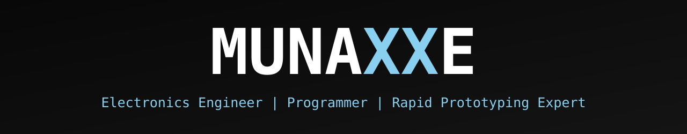

<a id="top"></a>

<div align="center">



<picture>
  <source media="(prefers-color-scheme: light)" srcset="https://readme-typing-svg.demolab.com?font=JetBrains+Mono&weight=500&size=18&duration=3200&pause=1200&color=56B4E9&center=true&vCenter=true&width=640&height=40&lines=Engineering+intelligent+systems.;Designing+and+building+electronic+solutions.;Connecting+hardware+and+software.;Developing+practical+technology.;Turning+concepts+into+working+prototypes.;Designing+products+and+digital+experiences.">
  
</picture>

<br>

<a href="#about"></a>
<a href="#engineering"></a>
<a href="#tech-stack"></a>
<a href="#projects"></a>
<a href="#design"></a>
<a href="#building"></a>
<a href="#contact"></a>


</div>

> *Bridging electronics, mechanical design, software and intelligent systems to turn ideas into practical solutions.*

---

<a id="about"></a>

## // ABOUT

I'm Munashe, an industrial electronics engineer based in Harare. I like problems that don't fit inside one discipline: a single product can need a circuit, a firmware loop, a mounting design and a web dashboard, and I enjoy being the person who can move between all four.

I hold a **First-Class BEng (Hons) in Industrial Electronics Engineering** and have close to three years of hands-on experience in electrical and solar systems: installation, commissioning, maintenance and fault diagnosis. Working on real installations keeps my designs practical.

Most of what I build sits between the physical and the digital: embedded devices, IoT and monitoring systems, automation, CAD models, and the software that ties them together.

```text
$ cat focus.txt
electronics · embedded · automation · CAD · software · IoT · renewable energy
```

---

<a id="engineering"></a>

## // ENGINEERING_DOMAINS

<details>
<summary><b>A · ELECTRONICS &amp; EMBEDDED SYSTEMS</b></summary>

`Microcontrollers` `Arduino` `ESP32` `Raspberry Pi` `C and C++` `Embedded programming` `Assembly language` `MikroC` `Electronic prototyping` `Circuit development`

</details>

<details>
<summary><b>B · AUTOMATION &amp; CONTROL</b></summary>

`PLC programming` `Industrial automation` `Industrial control systems` `Instrumentation` `Control logic` `Systems integration` `Electrical troubleshooting`

</details>

<details>
<summary><b>C · MECHANICAL DESIGN &amp; CAD</b></summary>

`SolidWorks` `AutoCAD` `3D modelling` `Mechanical component design` `Product design` `Structural design concepts` `Engineering drawings` `Mechanical prototyping`

</details>

<details>
<summary><b>D · ELECTRICAL &amp; ENERGY SYSTEMS</b></summary>

`Electrical installation` `Electrical fault diagnosis` `Solar systems` `Commissioning` `Preventive maintenance` `Renewable energy systems`

</details>

<details>
<summary><b>E · SOFTWARE &amp; WEB DEVELOPMENT</b></summary>

`Python` `C` `C++` `JavaScript` `HTML` `CSS` `Website development` `Application development` `APIs` `Git and GitHub`

</details>

<details>
<summary><b>F · CONNECTED &amp; INTELLIGENT SYSTEMS</b></summary>

`Internet of Things` `Smart home automation` `Robotics` `Security systems` `Remote monitoring` `Intelligent environments` `Connected devices`

</details>

---

<a id="tech-stack"></a>

## // TECH_STACK

**Programming**<br>
[](https://en.cppreference.com/w/c)
[](https://isocpp.org)
[](https://www.python.org)
[](https://developer.mozilla.org/docs/Web/JavaScript)
[](https://developer.mozilla.org/docs/Web/HTML)
[![CSS](https://img.shields.io/badge/CSS-141414?style=flat-square&logo=data%3Aimage%2Fsvg%2Bxml%3Bbase64%2CPHN2ZyBmaWxsPSIjODlDRkYwIiByb2xlPSJpbWciIHZpZXdCb3g9IjAgMCAyNCAyNCIgeG1sbnM9Imh0dHA6Ly93d3cudzMub3JnLzIwMDAvc3ZnIj48cGF0aCBkPSJNMCAwdjIwLjE2QTMuODQgMy44NCAwIDAgMCAzLjg0IDI0aDE2LjMyQTMuODQgMy44NCAwIDAgMCAyNCAyMC4xNlYzLjg0QTMuODQgMy44NCAwIDAgMCAyMC4xNiAwWm0xNC4yNTYgMTMuMDhjMS41NiAwIDIuMjggMS4wOCAyLjMwNCAyLjY0aC0xLjYwOGMuMDI0LS4yODgtLjA0OC0uNi0uMTQ0LS44NC0uMDk2LS4xOTItLjI4OC0uMjY0LS41NTItLjI2NC0uNDU2IDAtLjY5Ni4yNjQtLjY5Ni44NC0uMDI0LjU3Ni4yODguODg4Ljc2OCAxLjA4LjcyLjI4OCAxLjYwOC43NDQgMS45MiAxLjI5NnEuNDMyLjY0OC40MzIgMS42NTZjMCAxLjYwOC0uOTEyIDIuNTkyLTIuNDk2IDIuNTkyLTEuNjU2IDAtMi40LTEuMDMyLTIuNDI0LTIuNjg4aDEuNjhjMCAuNzkyLjI2NCAxLjE3Ni43OTIgMS4xNzYuMjY0IDAgLjQ1Ni0uMDcyLjU1Mi0uMjQuMTkyLS4zMTIuMjQtMS4xNzYtLjA0OC0xLjUxMi0uMzEyLS40MDgtLjkxMi0uNi0xLjMyLS44MTZxLS44MjgtLjM5Ni0xLjIyNC0uOTM2Yy0uMjQtLjM2LS4zNi0uODg4LS4zNi0xLjUzNiAwLTEuNDQuOTM2LTIuNDcyIDIuNDI0LTIuNDQ4bTUuNCAwYzEuNTg0IDAgMi4zMDQgMS4wOCAyLjMyOCAyLjY0aC0xLjYwOGMwLS4yODgtLjA0OC0uNi0uMTY4LS44NC0uMDk2LS4xOTItLjI2NC0uMjY0LS41MjgtLjI2NC0uNDggMC0uNzIuMjY0LS43Mi44NHMuMjg4Ljg4OC43OTIgMS4wOGMuNjk2LjI4OCAxLjYwOC43NDQgMS45MiAxLjI5Ni4yNjQuNDMyLjQwOC45ODQuNDA4IDEuNjU2LjAyNCAxLjYwOC0uODg4IDIuNTkyLTIuNDcyIDIuNTkyLTEuNjggMC0yLjQyNC0xLjA1Ni0yLjQ0OC0yLjY4OGgxLjY4YzAgLjc0NC4yNjQgMS4xNzYuNzkyIDEuMTc2LjI2NCAwIC40NTYtLjA3Mi41NTItLjI0LjIxNi0uMzEyLjI2NC0xLjE3Ni0uMDQ4LTEuNTEyLS4yODgtLjQwOC0uODg4LS42LTEuMzItLjgxNi0uNTUyLS4yNjQtLjk2LS41NzYtMS4yLS45MzZzLS4zNi0uODg4LS4zNi0xLjUzNmMtLjAyNC0xLjQ0LjkxMi0yLjQ3MiAyLjQtMi40NDhtLTExLjAzMS4wMThjLjcxMS0uMDA2IDEuNDE5LjE5OCAxLjgzOS42My40MzIuNDMyLjY3MiAxLjEyOC42NDggMS45OTJIOS4zMzZjLjAyNC0uNDU2LS4wOTYtLjc5Mi0uNDMyLS45Ni0uMzEyLS4xNDQtLjc2OC0uMDQ4LS44ODguMjQtLjEyLjI2NC0uMTkyLjU3Ni0uMTY4Ljg2NHYzLjUwNGMwIC43NDQuMjY0IDEuMTI4Ljc2OCAxLjEyOGEuNjUuNjUgMCAwIDAgLjU1Mi0uMjY0Yy4xNjgtLjI0LjE5Mi0uNTUyLjE2OC0uODRoMS43NzZjLjA5NiAxLjYzMi0uOTg0IDIuNzEyLTIuNTY4IDIuNjg4LTEuNTM2IDAtMi40OTYtLjg2NC0yLjQ3Mi0yLjQ3MnYtNC4wMzJjMC0uODE2LjI0LTEuNDQuNjk2LTEuODQ4LjQzMi0uNDA4IDEuMTQ2LS42MjQgMS44NTctLjYzIi8%2BPC9zdmc%2B)](https://developer.mozilla.org/docs/Web/CSS)
[](https://en.wikipedia.org/wiki/Assembly_language)

**Embedded Systems**<br>
[](https://www.arduino.cc)
[](https://www.espressif.com/en/products/socs/esp32)
[](https://www.raspberrypi.com)
[](https://www.mikroe.com/mikroc)

**CAD &amp; Design**<br>
[](https://www.solidworks.com)
[](https://www.autodesk.com/products/autocad/overview)
[](#design)
[](#design)

**Automation**<br>
[](https://en.wikipedia.org/wiki/Programmable_logic_controller)
[](https://en.wikipedia.org/wiki/Industrial_control_system)
[](https://en.wikipedia.org/wiki/Instrumentation)

**Software Development**<br>
[](https://git-scm.com)
[](https://github.com/munaxxe)
[](#projects)
[](https://en.wikipedia.org/wiki/API)

**Engineering**<br>
[](#projects)
[](#projects)
[](#engineering)
[](#building)
[](#engineering)
[](#engineering)

---

<a id="projects"></a>

## // FEATURED_PROJECTS

<a id="design"></a>

#### PRJ-01 · QUADCOPTER DESIGN (SOLIDWORKS)
 

<a href="https://github.com/Munaxxe/Quadcopter-Drone-Design-Munaxxe"></a>

A quadcopter modelled part by part in SolidWorks and brought together in a complete assembly: main body, motors, propellers with caps, and a camera with its mounting plate.

**Design focus:** `CAD modelling` `Mechanical design` `Component arrangement` `Structural considerations`

<details>
<summary>▸ DETAILS</summary>

- Stack: `SolidWorks` `Part modelling` `Assembly modelling`
- The image above is a render of the designed model.
- The repository contains the individual part files and the complete assembly (`CompleteDrone.SLDASM`).

</details>

[**REPOSITORY →**](https://github.com/Munaxxe/Quadcopter-Drone-Design-Munaxxe)

---

#### PRJ-02 · KUBERNETS HUB WEBSITE
 

<a href="https://kubernetshub.co.zw/"></a>

Multi-page business website with home, about, projects, store and contact pages.

**Stack:** `HTML` `CSS` `JavaScript`

<details>
<summary>▸ DETAILS</summary>

- Static site with its own custom domain configured in the repository.
- Built as part of my web development and digital solutions work.

</details>

[**REPOSITORY →**](https://github.com/munaxxe/kubernetshub) · [**LIVE SITE →**](https://kubernetshub.co.zw/)

---

#### PRJ-03 · WOLFSOFT ENGINEERING WEBSITE
 

<a href="https://wolfsoftengineering.co.zw/"></a>

Corporate website for WolfSoft Engineering, covering electrical and instrumentation, industrial and home automation, project management and electrical products distribution.

**Stack:** `HTML` `CSS` `JavaScript`

<details>
<summary>▸ DETAILS</summary>

- Home page with services, products, opening hours and a quote-request flow, plus a contact page and a promo video.
- The live site credits the design to Munaxxe.

</details>

[**REPOSITORY →**](https://github.com/munaxxe/WolfSoftEngineering) · [**LIVE SITE →**](https://wolfsoftengineering.co.zw/)

---

#### PRJ-04 · ESP32-CAM ROBOT CAR
 

<a href="https://github.com/munaxxe/ESP32-CAM-Robot-Car"></a>

Four-motor robot car built around an ESP32-CAM and an L298N motor driver, with a buzzer and a 7-12 V battery supply.

**Stack:** `ESP32-CAM` `C++ / Arduino` `L298N` `DC motors`

<details>
<summary>▸ DETAILS</summary>

- The battery feeds both the motor driver and the ESP32-CAM; four control lines run from the ESP32-CAM to the L298N, and a buzzer is wired to the ESP32-CAM.
- The repository contains the Arduino sketch (`ESP32-CAM_Robot_Car.ino`) and the wiring diagram shown above.

</details>

[**REPOSITORY →**](https://github.com/munaxxe/ESP32-CAM-Robot-Car)

---

<a id="building"></a>

## // CURRENTLY_BUILDING

<!-- Update this section as work evolves. -->

#### i2P · IDEA TO PROTOTYPE
 

<a href="https://github.com/munaxxe/i2p"></a>

A product concept that turns an idea into a realistic technical prototype. It is under development and not yet a finished platform. The vision:

- Visualise what a finished project could look like.
- Show the environment it would operate in.
- Demonstrate mounting and installation arrangements.
- Generate electronic circuit concepts.
- Identify the components and materials required.
- Help people see how their ideas could become real-world projects.

The [repository](https://github.com/munaxxe/i2p) holds the pre-launch website, with a launch target of 1 January 2027 (see [i2p.co.zw](https://i2p.co.zw/)).

#### IOT &amp; SMART HOME AUTOMATION


Customised connected devices, smart environments, home automation and remote monitoring.

#### EMERGING ENGINEERING SOLUTIONS


Practical applications of `Embedded intelligence` `Automation` `Assistive technology` `Smart security` `Robotics` `Connected environments` `Intelligent monitoring`

---

<a id="contact"></a>

## // OPEN_FOR_COLLABORATION

I'm open to collaborating on web design, AI, robotics and electronics projects. If you have an idea that needs hardware, firmware and software to work together, get in touch.

<a href="https://github.com/munaxxe"></a>
<a href="https://munaxxe.co.zw/"></a>
<a href="https://www.linkedin.com/in/munashe-walter-jojo"></a>
<a href="https://wa.me/263784600988"></a>
<a href="mailto:jojomunashe@gmail.com"></a>


<div align="right"><a href="#top"><sub>↑ BACK TO TOP</sub></a></div>
